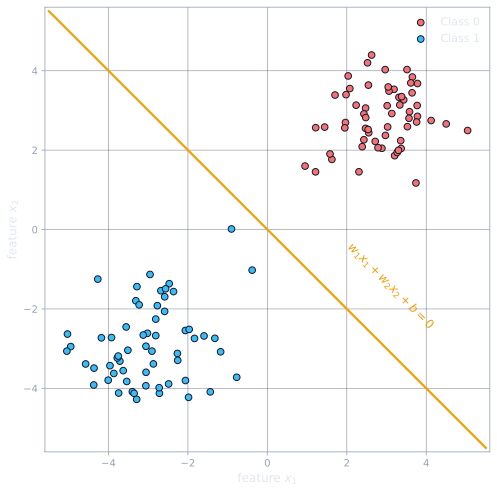
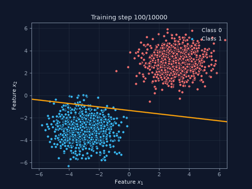
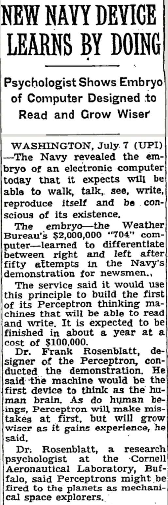
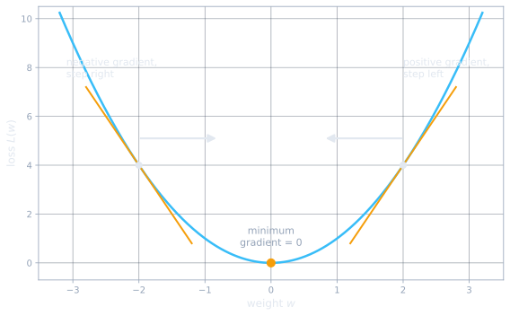
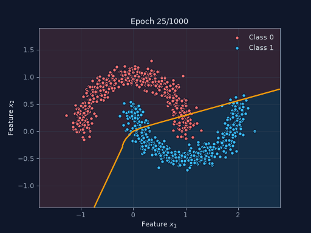

Traditional computer programming involves encoding real world problems into decision tree like representations in code. Such programs are deterministic, for a given input state the program follows the same route in the tree to get to identical output every time. Machine learning introduces the possibility of enabling computers to learn this decision tree given a set of curated input and output states (ignoring [unsupervised learning](https://en.wikipedia.org/wiki/Unsupervised_learning) to simplify here). At face value it is a steep promise, given enough data a computer is able to learn any decision tree and perform any real world task. In practice, for any problem worth solving, collecting the required labelled data and setting up a conducive learning architecture is non trivial. Neural networks are one such architecture: they have proven to be on par with or better than humans at image classification[^he], and the latest Transformer based networks match human performance on a range of language tasks when trained on reasonably sized datasets.

<pre class="mermaid">
flowchart LR
  subgraph TP["Traditional programming: encoding human expertise"]
    direction LR
    E["Human expertise"] --> RW["Hand-coded rules<br/>every situation anticipated,<br/>each rule coded, debugged, refined"] --> P1["Program"]
    IN1([Input]) --> P1 --> OUT1([Output])
  end
</pre>

<pre class="mermaid">
flowchart LR
  subgraph ML["Machine learning: learning from data"]
    direction LR
    EX["Labelled examples"] --> LA["Learning algorithm<br/>predict, compare,<br/>adjust on error"] --> W["Learned parameters"]
    IN2([Unseen input]) --> W --> OUT2([Output])
  end
</pre>

The next few posts document my pedagogical exercise of building a decoder only Transformer network from scratch[^karpathy]. The aim is to develop an intuitive understanding of the architecture most modern LLMs use and implement it from scratch in JAX, to reason about how massive models are designed piece by piece and what the learning process looks like for these networks. ***Intended as my notes for ML concepts, starting from basic math and computer science principles.*** To follow along, a basic understanding of linear algebra (matrix multiplication), calculus (gradients and partial derivatives), and Python programming is a prerequisite; no prior knowledge of machine learning is required.

<div class="collapsiblecontainer">
<div class="collapsibleheader"><span>+ </span>A note on terminology: model, network, LLM</div>
<div class="collapsiblecontent" markdown="1">
These posts use the terms *model*, *network*, and *LLM* somewhat interchangeably. Strictly speaking, the network is the architecture: the graph of operations together with its parameter slots. A model is a network combined with a specific set of learned parameter values. An LLM (large language model) is a model with a Transformer architecture whose parameters were trained on large text corpora.
</div>
</div>

### Perceptron, the first learning machine

The Perceptron, introduced by Frank Rosenblatt in 1958[^rosenblatt], is a binary classifier. He developed an iterative learning algorithm which _trains_ the network on a set of datapoints such that, when given an unseen example, the network produces the expected result, eliminating the need to encode every possible example and its outcome[^cornell]. In fact, starting from an arbitrary initial state, the algorithm is guaranteed to eventually converge to a solution that classifies 100% of the examples correctly, given such a solution exists[^novikoff].

<div class="collapsiblecontainer">
<div class="collapsibleheader"><span>+ </span>Historical context: from hand-coded rules to learned weights</div>
<div class="collapsiblecontent" markdown="1">
The perceptron was not the first mathematical model of a neuron. Warren McCulloch and Walter Pitts published one in 1943, but their neurons had fixed, hand-set connections; it was a theory of computation, not of learning. Rosenblatt's contribution at Cornell Aeronautical Laboratory was a working system that acquired its parameters from labelled examples[^brenndoerfer].

The urgency and funding came from the Cold War[^coldwar]. Military agencies wanted machines that could pick out aircraft or tanks in aerial photographs without teams of human analysts, and a pattern recognizer that adapts from examples promised exactly that. The contrast with the programming practice of the day was stark: an optical character recognizer, for instance, was built from hand-crafted rules about the loops and strokes of each letter, every rule individually coded, debugged, and refined. The perceptron replaced rule writing with data curation: instead of coding the rules, an engineer supplies labelled examples and lets the algorithm assign the feature weights. It also gave the field its first formal learning guarantee, the convergence theorem above.

The design borrowed loosely from biology: a neuron collects signals through its dendrites and fires down its axon once the combined stimulation crosses a threshold. The weighted sum and the step function mirror this behaviour exactly.
</div>
</div>

#### Problem statement

In order to motivate this topic, imagine developing a (traditional, deterministic) program to solve a classification problem of Shakespearean plays into Comedy and Not Comedy. For our purposes, assume we have a dataset with true/false binary labels for each work. A viable approach, rooted in familiarity with his work, is to check if the story [ends with at least one wedding](https://www.bellshakespeare.com.au/genres-of-shakespeares-plays). Given the volume of Shakespearean work it is expected this strategy only gives correct output for a small subset of all available examples. Making the strategy slightly more competent, let's add: if no main character dies, it is a comedy. It is evident that solving this problem with respectable levels of accuracy spanning all of Shakespeare's works will require a rigorous analysis of the dataset to discover emerging themes and develop corresponding rules.

Let's break this down into a simpler subproblem. Assume our data has two identified notable features (ending with a wedding, death of a character in our analogy) $x_1$ and $x_2$ that cleanly divide it into two classes. Mathematically, this can be represented as points in a two dimensional space with a clear boundary between two classes of points. Taking a geometry based shortcut to the solution, the general purpose [equation of a line](https://mathworld.wolfram.com/Line.html) in our two dimensional feature space is given by

$$w_1 x_1 + w_2 x_2 + b = 0 \tag{1}$$

This gives us our objective: given a set of points in 2D space, learn the parameters $w_1$, $w_2$, and $b$ of a line that divides the space with a different class of points on either side.

<figure>

<figcaption>An illustrative dataset: two classes of points in a 2D feature space, cleanly divided by the line of equation (1).</figcaption>
</figure>

The variable names are chosen intentionally to tie into ML naming conventions.

#### The architecture

The original [photoperceptron](https://com-cog-book.github.io/com-cog-book/features/perceptron.html) developed by Rosenblatt drew interesting inspirations from biology; we discuss a slight variation that is today most widely recognised as the Perceptron.

The notion of a linear function that outputs the class of a 2d point can be represented as a network of mathematical operations on the input coordinates.

<pre class="mermaid">
flowchart LR
  X1(["x₁"]) -- "w₁" --> S["Σ&nbsp;&nbsp;weighted sum<br/>w₁x₁ + w₂x₂ + b"]
  X2(["x₂"]) -- "w₂" --> S
  B(["b"]) --> S
  S -- "z" --> F["step function<br/>f(z), threshold T"]
  F --> Y(["y′ = 0 or 1"])
</pre>

$$y' = f(w_1 x_1 + w_2 x_2 + b) \tag{2}$$

where $f$ is the step function

$$f(z) = \begin{cases} 1 & \text{if } z \geq T \\ 0 & \text{if } z < T \end{cases} \tag{3}$$

The step function helps translate the continuous output of the linear function into discrete values which can be interpreted as classes. Note that the threshold $T$ is redundant given the bias: rewriting $z \geq T$ as $z - T \geq 0$ folds $T$ into $b$, so by convention the threshold is set to $0$.
Intuitively, this can be thought of as a weighted sum of features that govern a dataset. In the Shakespearean analogy, a wedding finale contributes differently to a particular work being a comedy than the death of a protagonist, and the combined effect must pass a certain threshold (step function) to qualify as a comedy.

To make this concrete, let us run two plays through the network using an assumed set of parameters. The features are binary: $x_1 = 1$ if the story ends with a wedding, $x_2 = 1$ if a main character dies, and a comedy is encoded as $y = 1$. Assume the network has the weights $w_1 = 0.8$, $w_2 = -0.9$, the bias $b = 0.2$, and a threshold of $0$.

For *A Midsummer Night's Dream*, which ends in weddings and spares its main characters, the input is $(x_1 = 1, x_2 = 0)$:

$$z = 0.8 \cdot 1 + (-0.9) \cdot 0 + 0.2 = 1.0 \geq 0 \implies y' = 1 \text{ (comedy)}$$

For *Hamlet*, where no wedding closes the play and the protagonist dies, the input is $(x_1 = 0, x_2 = 1)$:

$$z = 0.8 \cdot 0 + (-0.9) \cdot 1 + 0.2 = -0.7 < 0 \implies y' = 0 \text{ (not comedy)}$$

The wedding feature carries a positive weight and pushes the weighted sum over the threshold, while the death feature carries a negative weight and holds it under. Flipping the sign of either weight would cause the same inputs to produce wrong classifications: for a given input, the network's decision depends entirely on the values of $w_1$, $w_2$, $b$, and the threshold.
#### Learning algorithm

Generalizing over the dataset, for the $i$-th point $(x_{1i}, x_{2i})$, $y_i$ is the true label from the dataset and $y'_i$ is the network output:

$$y'_i = f(w_1 x_{1i} + w_2 x_{2i} + b) \tag{4}$$

<pre class="mermaid">
flowchart LR
  DS[("Dataset")] -- "(x₁ᵢ, x₂ᵢ)" --> N["Network"]
  N --> YP(["y′ᵢ&nbsp;&nbsp;prediction"])
  DS -- "label" --> Y(["yᵢ&nbsp;&nbsp;true value"])
  YP --> E["error<br/>yᵢ − y′ᵢ"]
  Y --> E
</pre>

The difference between the network output (prediction) and the true value, $y_i - y'_i$, represents the error in our classification. The algorithm states that for each datapoint, a correction equal to this error, scaled by a factor $\eta$, is applied to the parameters:

$$w_j \leftarrow w_j + \eta \, (y_i - y'_i) \, x_{ji} \qquad b \leftarrow b + \eta \, (y_i - y'_i) \tag{5}$$

The scaling factor $\eta$ controls the effect each wrong classification has on the parameter update. This is known as the learning rate, since increasing it means the program takes faster steps towards the right answers in the dataset. Eventually, after applying similar nudges for enough datapoints, the parameters converge to stable values that correctly classify the dataset. One adjustment step in this iterative process is illustrated in the following figure.

<pre class="mermaid">
flowchart TD
  DS[("Dataset")] -- "next point<br/>(x₁ᵢ, x₂ᵢ), yᵢ" --> N["Network<br/>w₁, w₂, b"]
  N -- "y′ᵢ" --> C["Compare<br/>error = yᵢ − y′ᵢ"]
  C -- "scale by η" --> U["Adjust w₁, w₂, b<br/>eq. (5)"]
  U -. "repeat for each point" .-> DS
</pre>

##### Learning visualized

The mathematical operations in the above pass through the network are succinctly represented by matrix multiplications (ideal for hardware acceleration when running this code, more on this later). Collecting the weights into a matrix $W$ and the inputs into a vector $\mathbf{x}$, equation (2) becomes:

$$y' = f(W\mathbf{x} + b), \qquad W = \begin{bmatrix} w_1 & w_2 \end{bmatrix}, \quad \mathbf{x} = \begin{bmatrix} x_1 \\ x_2 \end{bmatrix} \tag{6}$$

For a single perceptron, $W$ has one row. Each additional neuron in a layer adds a row, and the same matrix product computes every neuron's weighted sum at once.

Translating from English to Python gives us the following. We start with a dataset of two gaussian blobs in a 2D feature space, which stand in for our two classes of plays.

```python
import jax
import jax.numpy as jnp

# two gaussian blobs in 2D feature space, labelled 0 and 1, shuffled
def make_dataset(key, n_per_class=1000):
  k0, k1, kshuffle = jax.random.split(key, 3)
  # centres at +/-3 keep the blobs linearly separable even at 1000 points per class
  class0 = jax.random.normal(k0, (n_per_class, 2)) + 3.0
  class1 = jax.random.normal(k1, (n_per_class, 2)) - 3.0
  x = jnp.vstack([class0, class1])
  y = jnp.concatenate([jnp.zeros(n_per_class), jnp.ones(n_per_class)])
  # shuffle so the training loop sees the two classes interleaved
  indices = jax.random.permutation(kshuffle, jnp.arange(x.shape[0]))
  return x[indices], y[indices]
```

The network is a direct translation of equations (2), (3) and (6):

```python
# weighted sum of the inputs, equation (6): z = Wx + b
def layer(w, b, x):
  return jnp.dot(x, w) + b

# step activation, equation (3): 1 if z >= threshold else 0
def step(z, threshold=0.0):
  return jnp.where(z >= threshold, 1.0, 0.0)

# forward pass, equation (2): y' = f(Wx + b)
def perceptron(w, b, x):
  return step(layer(w, b, x))
```

The error and the update rule follow equation (5):

```python
# error for a single point: y - y'
def loss(y_true, y_pred):
  return (y_true - y_pred).squeeze()

# perceptron update rule, equation (5): nudge parameters by the scaled error
def update_weights(w, b, xi, error, lr):
  w = w + lr * error * xi.T
  b = b + lr * error
  return w, b
```

Each iteration of the training loop takes a dataset input value, passes it through the network, and then compares the result to the expected output. The difference dictates the adjustment in network parameters. Thus, with each step the network's decision boundary is nudged towards the correct final state. One full pass through every example in the dataset is called an epoch; the convergence theorem guarantees a solution after finitely many epochs on separable data, so a single epoch is often not enough.

```python
# a single learning step for one example: forward pass, error, update
def train_step(w, b, xi, yi, lr):
  y_pred = perceptron(w, b, xi)
  error = loss(yi, y_pred)
  return update_weights(w, b, xi, error, lr)

# one epoch = one pass through every example in the dataset
def train(w, b, x, y, lr=0.01, epochs=1):
  for epoch in range(epochs):
    for i in range(x.shape[0]):
      w, b = train_step(w, b, x[i].reshape(1, -1), y[i], lr)
  return w, b
```

Finally, we generate the data, initialize the parameters randomly, and train:

```python
rng = jax.random.key(42)

rng, subkey = jax.random.split(rng)
x, y = make_dataset(subkey)

# initialize parameters randomly, one key per parameter
rng, wkey, bkey = jax.random.split(rng, 3)
w = jax.random.normal(wkey, (2, 1))
b = jax.random.normal(bkey, (1,))

# five epochs is where this dataset reaches 100% accuracy, one is not enough
w, b = train(w, b, x, y, epochs=5)

accuracy = (perceptron(w, b, x).squeeze() == y).mean()  # 1.0
```

The JAX specific pieces, `jax.random.key` and the explicit key splitting, are covered in the [JAX section](#jax) below. The full notebook, including the plotting and animation code, is available [here](/assets/notebooks/perceptron.ipynb).

<figure>

<figcaption>Each misclassified point nudges the line, equation (5) in motion over five epochs of training.</figcaption>
</figure>

Take a moment to appreciate that from a simple loop in Python and some datapoints emerges spatial reasoning capability, in the feature dimensions, in a deterministic digital machine. The New York Times called this the "embryo of an electronic computer" at the time[^nyt].
<figure style="max-width: 240px; margin: 0 auto;">

<figcaption>The New York Times,<br/> July 8, 1958.</figcaption>
</figure>

It is evident from equation (2) that this network is capable of capturing (learning to represent) a linear relationship between the inputs and outputs. Most real world problems do not fit into this constraint. Marvin Minsky, interestingly a schoolmate of Rosenblatt[^bronx], along with Seymour Papert proved this limitation in their 1969 book *Perceptrons*[^minsky], showing a single layer perceptron cannot solve problems that are not linearly separable (the XOR gate being the canonical example), which led to the first of the AI winters in history.

Non-linearity in the network's representation is necessary to solve richer problems with it. In other words, real world problems often have a large number of features (think a higher dimensional feature space, instead of 2D) that affect the output, so the mathematical relation is a higher order function. A (surprisingly) straightforward avenue is adding more than one layer of the above matrix multiplications to the network.

### Multilayer perceptrons

There are two levers to pull: adding more layers to the network and increasing the number of neurons per layer.

<div class="collapsiblecontainer">
<div class="collapsibleheader"><span>+ </span>What is a neuron?</div>
<div class="collapsiblecontent" markdown="1">
A neuron (also called a unit or node) is the smallest building block of a network: it computes a weighted sum of its inputs, adds a bias, and applies an activation function, the same computation we saw in equation (2). A layer is a set of neurons that read the same inputs; in the matrix form of equation (6), each neuron is one row of $W$. The name is a loose biological metaphor and carries no further meaning here.
</div>
</div>

<pre class="mermaid">
%%{init: {"flowchart": {"nodeSpacing": 45, "rankSpacing": 90}}}%%
flowchart LR
  X1(["x₁"]) --> A1 & A2 & A3 & A4
  X2(["x₂"]) --> A1 & A2 & A3 & A4
  subgraph L1["Layer 1"]
    A1(("1")); A2(("2")); A3(("3")); A4(("4"))
  end
  subgraph L2["Layer 2"]
    B1(("1")); B2(("2")); B3(("3"))
  end
  A1 --> B1 & B2 & B3
  A2 --> B1 & B2 & B3
  A3 --> B1 & B2 & B3
  A4 --> B1 & B2
  A4 -- "w₄₃" --> B3
  B1 --> O(["y′"])
  B2 --> O
  B3 --> O
  classDef neuron font-size:22px
  class A1,A2,A3,A4,B1,B2,B3 neuron
  linkStyle default stroke:#475569,stroke-width:1px
  linkStyle 19 stroke:#F59E0B,stroke-width:3px
</pre>

The $w_i$ are parameters of the model; every arrow in the figure above carries one. As seen above, these control the contribution of a feature to the weighted sum, hence they are known as the weights of a model. The decision tree branching is controlled by the bias ($b$) and activation (step function) terms of a neuron. For instance, suppose that in the network above, neuron 3 in layer 2 should activate whenever neuron 4 in layer 1 is active. Training will assign a large weight to the link between them, labelled $w_{43}$ and highlighted in the figure, so that neuron 4's output dominates neuron 3's weighted sum and reliably pushes it over the activation threshold. For an individual neuron, its affinity to activate is controlled by the bias term and activation: a higher bias implies a higher weighted sum, and a lower activation threshold implies a lower value of the sum activates the neuron.

Two notable aspects of the learning algorithm are the measure of the error in its output and the incremental corrections to reduce this error. The error in ML papers is often referred to as the Loss. The raw difference $y - y'$ served the perceptron's update rule, but it makes a poor loss for deeper networks. A signed difference rewards overshooting in the negative direction, and taking its absolute value instead leaves a kink at zero where the derivative is undefined. Squaring the difference fixes both problems: the loss is positive for any mistake, smooth and differentiable everywhere, and its gradient grows with the size of the error, so badly wrong predictions produce large corrections while nearly correct ones barely move the weights[^goodfellow]. This gives the mean squared error, along with its square root, the root mean squared error. The differentiability is what deeper networks need, since they are trained by following gradients of the loss through every layer. Mathematically, the relation between input and output is represented by a complex higher order function. Unlike the linear case, each neuron (weight term) in a layer contributes to the loss differently. In order to correctly update each weight according to its effect on the loss, backpropagation is used. Think of the loss as a curve: for any given point on the curve, the direction of a minimum can be deduced using the slope of the tangent (gradient) at that point.

<figure>

<figcaption>The sign of the gradient tells us which side of the minimum we are on; stepping against it always reduces the loss.</figcaption>
</figure>

Hence, the partial derivative of the loss with respect to each weight gives the gradient at a point with respect to that weight, exactly what is needed here to update the weight. The weights in layers deeper into the network can be similarly derived using partial derivatives of the loss. Since the derivatives with respect to the weights of the following layer are already known, the chain rule can be used to avoid recalculations. Hence, the process of moving backwards in the network and calculating partial derivatives at each step using derivatives from a later step is known as backpropagation. The gradients can then be scaled and used to update the weights of the network during training. Andrej Karpathy's Zero to Hero series[^karpathy] is a great resource to understand this concept, as he manually shows the forward pass to get the loss and then the backward pass to propagate the gradients through a network.

#### JAX
[JAX](https://docs.jax.dev/en/latest/) is a Python framework which makes developing new network architectures and training them easier by abstracting away tedious parts like handrolling gradient calculations at each layer and weight updates.
<div class="collapsiblecontainer">
<div class="collapsibleheader"><span>+ </span>Why JAX over PyTorch?</div>
<div class="collapsiblecontent" markdown="1">
Both frameworks take care of the two genuinely tedious parts of deep learning, computing gradients automatically and running array math on accelerators. The difference lies in how much they manage for you. PyTorch wraps layers, parameter state, and training utilities into `nn.Module` objects that track everything behind the scenes. Working in JAX feels closer to working in NumPy. Parameters are ordinary data structures that you create and pass around yourself, and a model is a plain function that maps parameters and inputs to outputs. Since the goal of this exercise is to see every moving part, that explicitness is a feature rather than a burden, and it leaves room for more control once the networks get complicated. It also means there are fewer places for surprising behavior to hide. Pitfalls like the `keepdims` dilemma in reduction operations do not disappear, but they live in code you wrote and can inspect, instead of surfacing as silent training bugs somewhere inside a framework module.
</div>
</div>

#### Implementation and Training

The single perceptron grows into a multilayer network with surprisingly little new code. First we need a dataset that defeats a straight line; two interleaved half moons are the classic choice.

```python
# two interleaved half circles, a dataset no straight line can separate
def make_moons(key, n_per_class=500, noise=0.1):
  kt0, kt1, knoise, kshuffle = jax.random.split(key, 4)
  t0 = jax.random.uniform(kt0, (n_per_class,)) * jnp.pi
  t1 = jax.random.uniform(kt1, (n_per_class,)) * jnp.pi
  moon0 = jnp.stack([jnp.cos(t0), jnp.sin(t0)], axis=1)
  moon1 = jnp.stack([1.0 - jnp.cos(t1), 0.5 - jnp.sin(t1)], axis=1)
  x = jnp.vstack([moon0, moon1])
  x = x + noise * jax.random.normal(knoise, x.shape)
  y = jnp.concatenate([jnp.zeros(n_per_class), jnp.ones(n_per_class)])
  indices = jax.random.permutation(kshuffle, jnp.arange(x.shape[0]))
  return x[indices], y[indices]
```

Two changes turn the perceptron into a multilayer network. The step function gives way to smooth activations so that gradients can flow through every layer, and the single $(w, b)$ pair grows into a list of them, one per layer. The forward pass stacks the same `layer()` function we wrote for the perceptron.

```python
# smooth activations replace the step function so gradients can flow through them
def relu(z):
  return jnp.maximum(0.0, z)

def sigmoid(z):
  return 1.0 / (1.0 + jnp.exp(-z))

# one (w, b) pair per layer: sizes [2, 16, 16, 1] means 2 inputs,
# two hidden layers of 16 neurons each, and 1 output neuron
def init_mlp(key, sizes):
  params = []
  for n_in, n_out in zip(sizes[:-1], sizes[1:]):
    key, wkey = jax.random.split(key)
    params.append({'w': jax.random.normal(wkey, (n_in, n_out)) * jnp.sqrt(2.0 / n_in),
                   'b': jnp.zeros(n_out)})
  return params

# forward pass: the same layer() as the perceptron, stacked, with relu between
# hidden layers and a sigmoid squashing the output into (0, 1)
def mlp(params, x):
  h = x
  for p in params[:-1]:
    h = relu(layer(p['w'], p['b'], h))
  return sigmoid(layer(params[-1]['w'], params[-1]['b'], h)).squeeze()
```

The loss is the averaged squared error discussed above, written as a pure function of the parameters. That purity is what lets `jax.grad` differentiate it: the returned function computes the partial derivative of the loss with respect to every weight and bias in the network, backpropagation without writing a single derivative by hand. JAX calls the nested list of parameter dictionaries a pytree, and `jax.tree.map` applies the same update rule to every leaf in it at once.

```python
# squared error averaged over the dataset: smooth and differentiable everywhere,
# a pure function of the parameters so jax can differentiate it
def mse(params, x, y):
  return ((mlp(params, x) - y) ** 2).mean()

# jax.grad returns d(loss)/d(parameter) for every parameter in the pytree,
# backpropagation without writing a single derivative by hand
def train_mlp(params, x, y, lr=0.5, epochs=1000):
  grad_fn = jax.grad(mse)
  for epoch in range(epochs):
    grads = grad_fn(params, x, y)
    params = jax.tree.map(lambda p, g: p - lr * g, params, grads)
  return params
```

A thousand epochs of training reach 99.9% accuracy on the moons.

```python
rng, dkey, pkey = jax.random.split(rng, 3)
x_moons, y_moons = make_moons(dkey)

params = init_mlp(pkey, [2, 16, 16, 1])
params = train_mlp(params, x_moons, y_moons)

accuracy = ((mlp(params, x_moons) > 0.5) == y_moons).mean()  # 0.999
```

<figure>

<figcaption>The decision boundary bending around the moons as training progresses, a curve no single perceptron could draw.</figcaption>
</figure>

### Conclusion

Given enough data and a capable model architecture, interesting emergent properties are observed from the training process: without explicit mention of two classes or a classification problem, the network trains to fit the dataset and becomes capable of classifying unseen inputs correctly (assuming the unseen input follows the same patterns). Some key takeaways from the exercise here are:
- The number of features, the size of a network, and its architecture (how layers are structured and connected) dictate the nature of problems that it will be able to learn to solve with respectable accuracy.
- Non linearities in the network are important to enable it to model complex real world problems.
- The training process is more hands off than the original Bard example. For instance, selecting sarcasm and puns as features is not required. However, a good understanding of the major features that relate inputs to outputs will aid in better architecture of the network. This highlights two main problems with training capable networks: availability of clean, ample datasets for the problem at hand, and understanding of the dataset to be able to architect a model conducive to training.
- Since they are not explicitly encoded, the features a model identifies in a dataset as important (represented by higher weights assigned to the neuron) are non deterministic. In a sense, the model is a black box.
- As models get deeper, the choice of architecture, activations, and loss function dictates the model's ability to follow the gradient smoothly to a minimum on the loss curve. Various strategies to increase the likelihood of this convergence using a reasonable amount of data have been developed over the years. More on these in later posts as we use each to improve the network and its training.
+Anthropic discovering consciousness like properties in networks shows this black box nature and emergent properties, a sentence on this and a link out+

### References

[^karpathy]: This series is heavily inspired by Andrej Karpathy's [Neural Networks: Zero to Hero](https://karpathy.ai/zero-to-hero.html) lecture series, which is worth watching in full. These posts document a similar journey, building a Transformer based model from scratch, but in JAX, with a different set of examples for intuition and a different final product.
[^he]: He, K., Zhang, X., Ren, S., & Sun, J. (2015). [Delving Deep into Rectifiers: Surpassing Human-Level Performance on ImageNet Classification](https://arxiv.org/abs/1502.01852). IEEE International Conference on Computer Vision (ICCV).
[^rosenblatt]: Rosenblatt, F. (1958). [The perceptron: A probabilistic model for information storage and organization in the brain](https://doi.org/10.1037/h0042519). Psychological Review, 65(6), 386-408.
[^cornell]: [Professor's perceptron paved the way for AI, 60 years too soon](https://news.cornell.edu/stories/2019/09/professors-perceptron-paved-way-ai-60-years-too-soon). Cornell Chronicle, September 2019.
[^brenndoerfer]: Brenndoerfer, M. (2025). [The Perceptron, Foundation of Modern Neural Networks](https://mbrenndoerfer.com/writing/history-perceptron-neural-network-foundation).
[^coldwar]: Rosenblatt's perceptron research at Cornell Aeronautical Laboratory was funded by the U.S. Office of Naval Research, which staged the July 1958 public demonstration. See Olazaran, M. (1996). [A Sociological Study of the Official History of the Perceptrons Controversy](https://doi.org/10.1177/030631296026003005). Social Studies of Science, 26(3), 611-659.
[^novikoff]: Novikoff, A. B. (1962). On convergence proofs on perceptrons. Proceedings of the Symposium on the Mathematical Theory of Automata, 12, 615-622. Known as the perceptron convergence theorem.
[^nyt]: [New Navy Device Learns By Doing](https://www.nytimes.com/1958/07/08/archives/new-navy-device-learns-by-doing-psychologist-shows-embryo-of.html). The New York Times, July 8, 1958.
[^bronx]: Both attended the Bronx High School of Science, one year apart. See [Frank Rosenblatt](https://en.wikipedia.org/wiki/Frank_Rosenblatt), Wikipedia.
[^minsky]: Minsky, M., & Papert, S. (1969). *Perceptrons: An Introduction to Computational Geometry*. MIT Press.
[^goodfellow]: Goodfellow, I., Bengio, Y., & Courville, A. (2016). [Deep Learning](https://www.deeplearningbook.org/). MIT Press. Chapters 6 and 8 cover loss functions and the optimization difficulties of deep models.
