The [previous post]() introduced self-attention: Queries, Keys, Values and a softmax. Self-attention enables the model to capture semantic correlation between far apart words, allowing longer inputs. That in turn makes a rich context available to predict the output tokens. Transformers, as introduced in "Attention is all you need"[^vaswani], followed an encoder-decoder architecture with residual connections.

## Transformer encoder-decoder 

Both encoder and decoder are built from the same two sublayers, self-attention followed by a multilayer perceptron. The decoder has an additional cross-attention sublayer which attends over the encoder's output. Modern networks stack several such encoder and decoder layers (6 in the paper). The paper also introduces the following additions to the self-attention layer to improve overall model performance:

### 1. Residual connections, layer normalization and Scaled dot product attention

Deep neural networks (a high number of hidden layers) are prone to the exploding/vanishing gradient problem.

$$\text{output} = \text{LayerNorm}\left(x + \text{Sublayer}(x)\right)$$

Residual connections, $x +$ term[^resnet], adding the input back to the output allows the model to use gradients from deeper in the stack to apply meaningful updates during gradient descent. Layer normalization[^layernorm] transform the output of a layer such that its mean is 0 and variance 1. Scaling numbers into this range keeps the activation function, softmax in this case, out of the regions with really low gradient values.


<div class="collapsiblecontainer">
<div class="collapsibleheader"><span>+ </span>Post-norm and pre-norm</div>
<div class="collapsiblecontent" markdown="1">
The formula above applies the normalization after the residual addition, referred to as post-norm. $x + \text{Sublayer}(\text{LayerNorm}(x))$, pre-norm, adding the residual input to normalized output of a layer. Post norm produces disproportionately large gradients during initialization [^xiong]. The Transformer paper uses a learning rate warmup schedule during training to combat this issue. The implementation later in this post uses pre-norm which does not have this limitation.
</div>
</div>


Attention scores are scaled by $\sqrt{d_k}$ before the softmax to solve for the same issue:

$$\text{Attention}(Q, K, V) = \text{softmax}\!\left(\frac{QK^T}{\sqrt{d_k}}\right)V$$


### 2. Multi-head attention

 Multi-head attention runs $h$ copies of the mechanism in parallel, each with its own query, key and value projection, and concatenates their outputs. This gives the model more independent representation spaces to allow capturing more context from the input. Intuitively, a sentence consists of multiple relevant contexts to convey full meaning. For instance, resolving a pronoun, tracking which noun a verb agrees with, and finding the object of a preposition are separate lookups.

<figure>
<pre class="mermaid">
%%{init: {"flowchart": {"nodeSpacing": 45, "rankSpacing": 60}}}%%
flowchart TB
  H["Input sequence H<br/>(n × d_model)"]

  A1["head₁<br/>own W_Q, W_K, W_V<br/>(n × dₖ)"]
  A2["head₂<br/>own W_Q, W_K, W_V<br/>(n × dₖ)"]
  A3["…"]
  A4["headₕ<br/>own W_Q, W_K, W_V<br/>(n × dₖ)"]

  CAT["Concatenate<br/>(n × h·dₖ = n × d_model)"]
  WO["× W_O<br/>(d_model × d_model)"]
  OUT["Output<br/>(n × d_model)"]

  H ==> A1 & A2 & A3 & A4
  A1 & A2 & A3 & A4 ==> CAT ==> WO ==> OUT

  classDef input fill:#0f172a,stroke:#38bdf8,stroke-width:2px,color:#f8fafc
  classDef head fill:#4c1d95,stroke:#a855f7,stroke-width:1.5px,color:#f8fafc
  classDef inter fill:#1e293b,stroke:#94a3b8,stroke-width:1.5px,color:#f8fafc
  classDef out fill:#7c2d12,stroke:#f97316,stroke-width:2px,color:#ffffff

  class H input
  class A1,A2,A3,A4 head
  class CAT,WO inter
  class OUT out
</pre>
<figcaption>Every head is the attention module from the previous post, run at width dₖ = d_model / h.</figcaption>
</figure>

### 3. Masked self-attention

Self-attention as built so far tokens at every position attend to every other position. This is wrong for the sentence generation use case. A language model generates one token at a time, each conditioned on the tokens before it. If during training position $i$ attends to position $i+1$, the model learns to read the answer off its own input, which will be unavailable when generating using unseen input contexts. In the the grid representation of the Attention scores, lower triangle is set to zero (masked) so $i^{th}$ token does not have any influence on the representations captured for tokens $i_{1}$ to $i_{i-1}$. The mask is applied before the softmax, with the masked entries set to $-\infty$.

<!--TODO: fix diagram lower triangle must be zero -->
<figure markdown="1">

$$
\underbrace{
\begin{bmatrix}
s_{11} & {\color{#F59E0B}-\infty} & {\color{#F59E0B}-\infty} & {\color{#F59E0B}-\infty} \\
s_{21} & s_{22} & {\color{#F59E0B}-\infty} & {\color{#F59E0B}-\infty} \\
s_{31} & s_{32} & s_{33} & {\color{#F59E0B}-\infty} \\
s_{41} & s_{42} & s_{43} & s_{44}
\end{bmatrix}
}_{\text{masked scores}}
\;\xrightarrow{\;\text{softmax by row}\;}\;
\underbrace{
\begin{bmatrix}
1 & {\color{#F59E0B}0} & {\color{#F59E0B}0} & {\color{#F59E0B}0} \\
\alpha_{21} & \alpha_{22} & {\color{#F59E0B}0} & {\color{#F59E0B}0} \\
\alpha_{31} & \alpha_{32} & \alpha_{33} & {\color{#F59E0B}0} \\
\alpha_{41} & \alpha_{42} & \alpha_{43} & \alpha_{44}
\end{bmatrix}
}_{\text{attention weights, rows sum to 1}}
$$

<figcaption>The mask is applied to the scores. Each row of the result is a probability distribution, over a shorter prefix</figcaption>
</figure>

### 4. Positional encoding

Sequentially processing input tokens allowed RNNs to capture ordered nature of language syntax. Attention on the other hand is reads everything at once, and the mechanism is permutation invariant: shuffling the rows of the input causes the rows of the output to shuffle identically, with the same values ($QK^T$), so "dog bites man" and "man bites dog" would produce the same set of representations.

The paper adds positional embeddings to the input of the network. Using sinusoids allows the model to capture relative distances between tokens alongside the semantic relationships.

$$PE_{(pos, 2i)} = \sin\!\left(\frac{pos}{10000^{2i/d_{model}}}\right), \qquad PE_{(pos, 2i+1)} = \cos\!\left(\frac{pos}{10000^{2i/d_{model}}}\right)$$

#### Rotary Position Embeddings

Adding a position signal to the embedding passes on the task of learning the semantics of a token and its position in the sentence upto to the network. RoPE[^rope] avoids that. Instead of adding anything to the input, it rotates each query and key vector, in two-dimensional slices, by an angle proportional to its position. Because a dot product between two rotated vectors depends only on the difference of their angles, the score between positions $m$ and $n$ comes out as a function of $m - n$ automatically, so relative position is built into the attention computation rather than something the network has to learn to extract. Most current open models use it. EleutherAI's [write-up](https://blog.eleuther.ai/rotary-embeddings/) is a good resource for further reading.

<!-- TODO: fix diagram, maybe just add from the paper. the encoder should input  to cross attention -->
<figure>
<pre class="mermaid">
%%{init: {"flowchart": {"nodeSpacing": 40, "rankSpacing": 55, "padding": 30}}}%%
flowchart TB
  SRC["Source tokens<br/>+ positional encoding"]
  TGT["Target tokens so far<br/>+ positional encoding"]

  subgraph ENC["Encoder layer (× 6)"]
    direction TB
    ESA["Self-attention<br/>every position sees every other"] --> EFF["Feed-forward network"]
  end

  subgraph DEC["Decoder layer (× 6)"]
    direction TB
    DSA["Masked self-attention<br/>each position sees only its prefix"] --> DCA["Cross-attention<br/>queries from the decoder,<br/>keys and values from the encoder"] --> DFF["Feed-forward network"]
  end

  SRC ==> ESA
  TGT ==> DSA
  EFF ==>|"encoder output"| DCA
  DFF ==> OUT["Linear to vocabulary<br/>→ next target token"]

  classDef input fill:#0f172a,stroke:#38bdf8,stroke-width:1.5px,color:#f8fafc
  classDef attn fill:#4c1d95,stroke:#a855f7,stroke-width:1.5px,color:#f8fafc
  classDef cross fill:#1e293b,stroke:#94a3b8,stroke-width:1.5px,color:#f8fafc
  classDef ff fill:#065f46,stroke:#34d399,stroke-width:1.5px,color:#f8fafc
  classDef out fill:#7c2d12,stroke:#f97316,stroke-width:2px,color:#ffffff

  class SRC,TGT input
  class ESA,DSA attn
  class DCA cross
  class EFF,DFF ff
  class OUT out
</pre>
<figcaption>The two stacks of the original architecture. Each sublayer shown here is wrapped in a residual connection and a layer normalization, left out to keep the diagram readable; they are the subject of the next section.</figcaption>
</figure>
## The feed-forward network

Also known as a multilayer perceptron [^first]: two linear layers with a non-linearity between them.

$$\text{FFN}(x) = \max(0, xW_1 + b_1)W_2 + b_2$$

The inner width $d_{ff}$ is conventionally four times $d_{model}$, so the vector is projected up, passed through a ReLU, and projected back down. The division of labour is noteworthy: attention is the part of the architecture that moves information between tokens at different positions, and the feed-forward network is the part that does non-linear processing on what a position has collected. Attention on its own is a weighted average, which is a linear operation, so without this sublayer stacking layers would collapse into something not much more expressive than a single one.

It is also where most of the parameters are. In one layer, four attention projections of $d_{model} \times d_{model}$ come to $4d_{model}^2$, while the feed-forward network's two matrices come to $8d_{model}^2$, roughly two thirds of the layer.

## Decoder-only transformers

The encoder-decoder split makes sense for translation, where there are two distinct sequences: a source sentence to read and a target sentence to write. For autoregressive generation, continuing a sequence one token at a time, there is only one sequence, so the encoder and the cross-attention in the decoder that reads from it are redundant. Dropping both leaves a stack of blocks containing masked self-attention and a feed-forward network. That is the decoder-only transformer, the architecture behind GPT[^radford2018] [^radford2019] and essentially every large language model since.

<figure>
<pre class="mermaid">
%%{init: {"flowchart": {"nodeSpacing": 40, "rankSpacing": 55, "padding": 30}}}%%
flowchart TB
  TOK["Token ids"] --> EMB["Token embedding<br/>+ positional encoding"]

  subgraph BLK["Block (x N)"]
    direction TB
    N1["LayerNorm"] --> SA["Masked multi-head self-attention"] --> R1["+ residual"]
    R1 --> N2["LayerNorm"] --> FF["Feed-forward network"] --> R2["+ residual"]
  end

  EMB ==> N1
  R2 ==> FN["Final LayerNorm"] ==> UNEMB["Linear to vocabulary"] ==> LOG["Logits<br/>one score per token in the vocabulary,<br/>for every position"]

  classDef input fill:#0f172a,stroke:#38bdf8,stroke-width:1.5px,color:#f8fafc
  classDef attn fill:#4c1d95,stroke:#a855f7,stroke-width:1.5px,color:#f8fafc
  classDef norm fill:#1e293b,stroke:#94a3b8,stroke-width:1.5px,color:#f8fafc
  classDef ff fill:#065f46,stroke:#34d399,stroke-width:1.5px,color:#f8fafc
  classDef out fill:#7c2d12,stroke:#f97316,stroke-width:2px,color:#ffffff

  class TOK,EMB input
  class SA attn
  class N1,N2,R1,R2,FN norm
  class FF ff
  class UNEMB,LOG out
</pre>
<figcaption>The decoder-only stack. Note the pre-norm arrangement.</figcaption>
</figure>


As alluded to above for the autregressive task, **The training objective** is next-token prediction: given a sequence, predict the token that follows at every position at once. The causal mask allows processing multiple input tokens in one forward pass of the network. The next-token prediction objective generalizes across code generation, language translation and arithmetic given enough training examples for each type of task. Predicting the next token well enough, over a large enough corpus, requires learning whatever structure the corpus contains. In order to use this model as a chatbot/assistant, **Post-training**, the trained base model undergoes supervised fine-tuning on curated examples, reinforcement learning from feedback, and a, a system prompt, which is simply tokens prepended to the contextthat nudges the model towards a desired output. ChatGPT and Gemini are base models plus these layers and additional training.

<div class="collapsiblecontainer">
<div class="collapsibleheader"><span>+ </span>Reasoning models, and what a "high effort" setting on a chatbot (likely) does?</div>
<div class="collapsiblecontent" markdown="1">
A base model trained only on next-token prediction imitates its training corpus. In order to improve a model's reasoning capabilities and getting it to solve complex problems reliably takes a second training stage, reinforcement learning[^deepseekr1]. The model is given a problem, allowed to sample a complete response from its own output distribution, the response is scored and model weights updated such that desired behaviour lead to higher scores and become more likely. The score comes either from a reward model trained on human preference comparisons between pairs of responses[^ouyang], or, for domains where correctness can be checked mechanically, from the check itself, unit tests passing or a math answer matching. Thus, modern language models perform well at tasks whose output correctness can be verified objectively.

From the reinforcement learning, a reasoning model learns to spend tokens before committing to an answer. It spends tokens to: restate the problem, break it into parts, work through them, notice a contradiction and backtrack. These intermediate tokens are ordinary generated tokens, produced by the model. An "effort" or "thinking budget" control is a dial on how many of the tokens the model may spend before it has to answer. Turned up, the model explores more of that intermediate work and usually does better on problems that decompose into steps; turned down, it answers sooner and costs less. Most modern modern are not open-sourced hence, in lieu of implementation details this is an educated guess as to how the effort dial actually works.
</div>
</div>

## Implementing it in JAX

The pieces above amount to little code. As in the previous post the implementation uses Flax[^flax], and again it reimplements something the library already provides, [`nnx.MultiHeadAttention`](https://flax.readthedocs.io/en/stable/api_reference/flax.nnx/nn/attention.html), for learning purposes.

### Efficient Multi-Head Attention implementation

According to the definition, Multi-Head Attention is simply an array of Self Attention blocks which operate sequentially on the input during a forward pass (recall, the dunder `__call__` method). The main advantage of Multi-Head over single head attention is that independent heads of attention allows the model to capture more context from the input into independent spaces. The same behavior can be achieved by using a scaled version of Query, Keys and Values (scaled by the number of heads) that operate on different sets of dimensions of input token embeddings. This maintains the independent nature of each head but allows running the Attention mechanism across all heads in parallel. This makes the computation highly efficient and can be scales better for massive networks and embedding spaces. 

```python
class MultiHeadAttention(nnx.Module):
  def __init__(self, n_heads, embed_dim, rngs: nnx.Rngs):
    self.n_heads = n_heads
    self.head_dim = embed_dim // n_heads

    # input: Batch(B), Context Len(L), Embedding dim(E)
    # MultiHead Attention
    #   so each head takes slice of the embeddings
    #   for each token in context as input
    #   therefore, for each head dimensions will be
    #   input: B, L, E // n_heads


    self.q_proj = nnx.Linear(in_features, in_features, use_bias=False, rngs=rngs)
    self.k_proj = nnx.Linear(in_features, in_features, use_bias=False, rngs=rngs)
    self.v_proj = nnx.Linear(in_features, in_features, use_bias=False, rngs=rngs)

    self.out_proj = nnx.Linear(in_features, in_features, use_bias=False, rngs=rngs)

  def __call__(self, input_ids):
    x = input_ids

    B, L, E = x.shape

    queries = self.q_proj(x)
    keys = self.k_proj(x)
    values = self.v_proj(x)

    # Distributing the embedding across heads
    queries = queries.reshape(B, L, self.n_heads, self.head_dim)
    keys = keys.reshape(B, L, self.n_heads, self.head_dim)
    values = values.reshape(B, L, self.n_heads, self.head_dim)

    # Reshaping so the operations are carried over each token embedding
    # dimension(3), for each token in the sequence (1), for each attention
    # head (2), for each batch input token sequences (0)
    # could use swapaxes here as well; the following reads better to me
    queries = queries.transpose(0, 2, 1, 3)
    keys = keys.transpose(0, 2, 1, 3)
    values = values.transpose(0, 2, 1, 3)

    # scaled
    alignment_scores = queries @ keys.transpose(0, 1, 3, 2)
    alignment_scores = alignment_scores / math.sqrt(queries.shape[-1])

    # masked
    mask = jnp.tril(jnp.ones(alignment_scores.shape))
    alignment_scores = jnp.where(mask == 0, alignment_scores, -1e5)

    alignment_scores = jax.nn.softmax(alignment_scores)

    attention_values = alignment_scores @ values
    attention_values = attention_values.transpose(0, 2, 1, 3)

    attention_values = attention_values.reshape(B, L, E)

    attention_values = self.out_proj(attention_values)

    return attention_values
```
Hence, the Transformer takes the above Multi-Head Attention and combines it with Multilayer Perceptrons via layer normalizations and residual connections.

```python
class Transformer(nnx.Module):
  def __init__(self, embed_dim, n_heads, mlp_hidden_dim, rngs: nnx.Rngs):
    self.attention = MultiHeadAttention(n_heads, embed_dim, rngs)
    self.mlp = MLP(embed_dim, mlp_hidden_dim, embed_dim, rngs)

    self.ln1 = nnx.LayerNorm(embed_dim, rngs=rngs)
    self.ln2 = nnx.LayerNorm(embed_dim, rngs=rngs)

  def __call__(self, input_ids):
    x = input_ids
    norm_x = self.ln1(x)
    attention = self.attention(norm_x)

    x = x + attention
    norm_x = self.ln2(x)

    mlp_output = self.mlp(norm_x)

    return mlp_output + x
```

A forward pass through a transformer returns a `B, L, V` output, where `V` is the vocabulary size. So, for each token in every batch the output is a score for each word in the vocabulary representing its likelihood of being the next token in the sequence.

<figure>
<pre class="mermaid">
%%{init: {"flowchart": {"nodeSpacing": 35, "rankSpacing": 60}}}%%
flowchart LR
  T["token_ids<br/>(1 × 12)"]
  E["embed + pos<br/>(1 × 12 × 64)"]
  Q["queries, keys, values<br/>per head, ×4<br/>(1 × 12 × 16)"]
  S["scores, masked<br/>per head, ×4<br/>(1 × 12 × 12)"]
  M["concatenated heads<br/>(1 × 12 × 64)"]
  F["feed-forward<br/>(1 × 12 × 256) → (1 × 12 × 64)"]
  L["logits<br/>(1 × 12 × 1000)"]

  T ==> E ==> Q ==> S ==> M ==> F ==> L

  classDef input fill:#0f172a,stroke:#38bdf8,stroke-width:1.5px,color:#f8fafc
  classDef attn fill:#4c1d95,stroke:#a855f7,stroke-width:2px,color:#f8fafc
  classDef inter fill:#1e293b,stroke:#94a3b8,stroke-width:1.5px,color:#f8fafc
  classDef ff fill:#065f46,stroke:#34d399,stroke-width:1.5px,color:#f8fafc
  classDef out fill:#7c2d12,stroke:#f97316,stroke-width:2px,color:#ffffff

  class T,E input
  class Q,S attn
  class M inter
  class F ff
  class L out
</pre>
<figcaption>Shapes through one block of the model instantiated above, d_model = 64 split into four heads of 16. The sequence length 12 appears twice in the score matrix, the quadratic cost from the previous post.</figcaption>
</figure>

## Key Takeaways

- Most of the architecture is scaffolding around the Attention primitive: residual connections so gradients survive the network depth, normalization so activations stay in range, several heads so a layer can attend to more than one thing, and a feed-forward sublayer to supply the non-linearity.
- Two adjustments to the primitive itself, first, scaling by $\sqrt{d_k}$ in order to keep softmax out of its flat region so gradients do not vanish and second, a causal mask, which ensures future tokens do not influence past ones in any way. 
- Decoder only for autoregressive generation.

<figure>

<figcaption markdown="1">Transformer is a loaded term now. <br/>Left, W. Stanley Jr., *Induction Coil*, [US 349,611](https://commons.wikimedia.org/wiki/File:StanleyTransformer2.png) (1886). Centre, H. Obara, reconfigurable toy assembly, [US 4,516,948](https://commons.wikimedia.org/wiki/File:Optimus_Prime_patent.png) (filed 1984). Right, "Attention is all you need", 2017
</figcaption>
</figure>

## References

Inspired by, Andrej Karpathy's [Let's build GPT: from scratch, in code, spelled out](https://youtu.be/kCc8FmEb1nY) builds an equivalent model in PyTorch, Harvard NLP's [The Annotated Transformer](http://nlp.seas.harvard.edu/annotated-transformer/) annotates the original paper with running code, and the [Transformer Explainer](https://poloclub.github.io/transformer-explainer/) runs a real GPT-2 in the browser.

[^vaswani]: Vaswani, A., Shazeer, N., Parmar, N., Uszkoreit, J., Jones, L., Gomez, A. N., Kaiser, Ł., & Polosukhin, I. (2017). [*Attention Is All You Need.*](https://arxiv.org/abs/1706.03762) Advances in Neural Information Processing Systems (NeurIPS). For a highly visual walkthrough of the architecture, see [Jay Alammar's *The Illustrated Transformer*](https://jalammar.github.io/illustrated-transformer/).
[^resnet]: He, K., Zhang, X., Ren, S., & Sun, J. (2015). [*Deep Residual Learning for Image Recognition.*](https://arxiv.org/abs/1512.03385) IEEE Conference on Computer Vision and Pattern Recognition (CVPR).
[^layernorm]: Ba, J. L., Kiros, J. R., & Hinton, G. E. (2016). [*Layer Normalization.*](https://arxiv.org/abs/1607.06450)
[^xiong]: Xiong, R., Yang, Y., He, D., Zheng, K., Zheng, S., Xing, C., Zhang, H., Lan, Y., Wang, L., & Liu, T.-Y. (2020). [*On Layer Normalization in the Transformer Architecture.*](https://proceedings.mlr.press/v119/xiong20b/xiong20b.pdf) Proceedings of the 37th International Conference on Machine Learning (ICML).
[^rope]: Su, J., Lu, Y., Pan, S., Murtadha, A., Wen, B., & Liu, Y. (2021). [*RoFormer: Enhanced Transformer with Rotary Position Embedding.*](https://arxiv.org/abs/2104.09864)
[^radford2018]: Radford, A., Narasimhan, K., Salimans, T., & Sutskever, I. (2018). [*Improving Language Understanding by Generative Pre-Training.*](https://cdn.openai.com/research-covers/language-unsupervised/language_understanding_paper.pdf) OpenAI.
[^radford2019]: Radford, A., Wu, J., Child, R., Luan, D., Amodei, D., & Sutskever, I. (2019). [*Language Models are Unsupervised Multitask Learners.*](https://cdn.openai.com/better-language-models/language_models_are_unsupervised_multitask_learners.pdf) OpenAI. For a visual walkthrough, see [Jay Alammar's *The Illustrated GPT-2*](https://jalammar.github.io/illustrated-gpt2/).
[^flax]: [Flax documentation](https://flax.readthedocs.io/en/stable/key_concepts.html)
[^rmsnorm]: Zhang, B., & Sennrich, R. (2019). [*Root Mean Square Layer Normalization.*](https://arxiv.org/abs/1910.07467) Advances in Neural Information Processing Systems (NeurIPS).
[^shazeer]: Shazeer, N. (2020). [*GLU Variants Improve Transformer.*](https://arxiv.org/abs/2002.05202)
[^gqa]: Ainslie, J., Lee-Thorp, J., de Jong, M., Zemlyanskiy, Y., Lebrón, F., & Sanghai, S. (2023). [*GQA: Training Generalized Multi-Query Transformer Models from Multi-Head Checkpoints.*](https://arxiv.org/abs/2305.13245) Conference on Empirical Methods in Natural Language Processing (EMNLP).
[^ouyang]: Ouyang, L., Wu, J., Jiang, X., Almeida, D., Wainwright, C., Mishkin, P., Zhang, C., Agarwal, S., Slama, K., Ray, A., et al. (2022). [*Training Language Models to Follow Instructions with Human Feedback.*](https://arxiv.org/abs/2203.02155) Advances in Neural Information Processing Systems (NeurIPS).
[^ppo]: Schulman, J., Wolski, F., Dhariwal, P., Radford, A., & Klimov, O. (2017). [*Proximal Policy Optimization Algorithms.*](https://arxiv.org/abs/1707.06347)
[^grpo]: Shao, Z., Wang, P., Zhu, Q., Xu, R., Song, J., Bi, X., Zhang, H., Zhang, M., Li, Y. K., Wu, Y., & Guo, D. (2024). [*DeepSeekMath: Pushing the Limits of Mathematical Reasoning in Open Language Models.*](https://arxiv.org/abs/2402.03300) The paper that introduced GRPO.
[^deepseekr1]: DeepSeek-AI (2025). [*DeepSeek-R1: Incentivizing Reasoning Capability in LLMs via Reinforcement Learning.*](https://arxiv.org/abs/2501.12948)
[^first]: The multilayer perceptron was built in [the first post in this series]().

