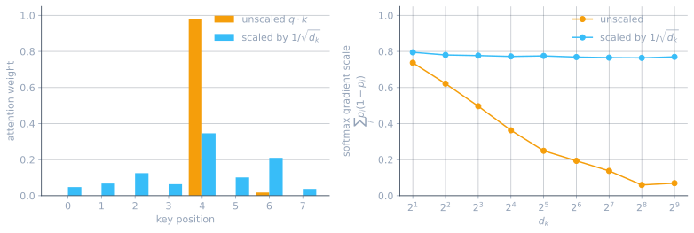
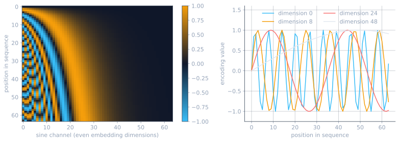

The [previous post]() ended with self-attention: one sequence, three learned projections, a softmax, and two matrix multiplications. That primitive fixed both problems the recurrent encoder-decoder had, the fixed-size context bottleneck and the strictly sequential read, but on its own it is not a model. A single attention layer computes one weighted average per position, and stacking weighted averages does not by itself give depth, stability, or any notion of word order. Vaswani et al. (2017)[^vaswani] supplied the missing scaffolding and showed that once it is in place the recurrence can be dropped entirely, which is where the paper's title comes from. This post assembles that scaffolding piece by piece, then strips the architecture down to the decoder-only stack that modern language models actually use, and implements it in JAX.

## The full architecture

The paper's model is a stack of encoder layers feeding a stack of decoder layers, six of each, built for translation. An encoder layer is self-attention followed by a small feed-forward network. A decoder layer is the same, plus a middle sublayer that attends over the encoder's output. Every sublayer is wrapped in a residual connection and a layer normalization, and there are three distinct attention sites in the model, all of them the same mechanism from the previous post with different things plugged into the query, key and value slots:

- **Encoder self-attention.** $Q$, $K$, $V$ all come from the input sequence. Every English word looks at every other English word, in both directions.
- **Decoder masked self-attention.** $Q$, $K$, $V$ all come from the output sequence generated so far, with a mask that stops a position from looking at positions to its right.
- **Decoder cross-attention.** $Q$ comes from the decoder, $K$ and $V$ come from the top encoder layer. This is exactly the cross-attention built in the previous post, where the decoder searched back over the encoder's hidden states, now with the recurrence removed from both sides.

<figure>
<pre class="mermaid">
%%{init: {"flowchart": {"nodeSpacing": 40, "rankSpacing": 55, "padding": 30}}}%%
flowchart TB
  IN["Input embeddings + positional encoding"]

  subgraph ENC["Encoder layer (x6)"]
    direction TB
    ESA["Multi-head self-attention"] --> EAN1["Add and Norm"]
    EAN1 --> EFF["Feed-forward network"] --> EAN2["Add and Norm"]
  end

  OUT_EMB["Output embeddings, shifted right<br/>+ positional encoding"]

  subgraph DEC["Decoder layer (x6)"]
    direction TB
    DSA["Masked multi-head self-attention"] --> DAN1["Add and Norm"]
    DAN1 --> DCA["Multi-head cross-attention"] --> DAN2["Add and Norm"]
    DAN2 --> DFF["Feed-forward network"] --> DAN3["Add and Norm"]
  end

  LOGITS["Linear projection to vocabulary, softmax"]

  IN ==> ESA
  OUT_EMB ==> DSA
  EAN2 == "keys and values" ==> DCA
  DAN3 ==> LOGITS

  classDef input fill:#0f172a,stroke:#38bdf8,stroke-width:1.5px,color:#f8fafc
  classDef attn fill:#4c1d95,stroke:#a855f7,stroke-width:1.5px,color:#f8fafc
  classDef norm fill:#1e293b,stroke:#94a3b8,stroke-width:1.5px,color:#f8fafc
  classDef ff fill:#065f46,stroke:#34d399,stroke-width:1.5px,color:#f8fafc
  classDef out fill:#7c2d12,stroke:#f97316,stroke-width:2px,color:#ffffff

  class IN,OUT_EMB input
  class ESA,DSA,DCA attn
  class EAN1,EAN2,DAN1,DAN2,DAN3 norm
  class EFF,DFF ff
  class LOGITS out
</pre>
<figcaption>One encoder layer and one decoder layer, with six of each stacked in the paper's model. The only connection between the two stacks is the arrow carrying the encoder's output into the decoder's cross-attention as keys and values.</figcaption>
</figure>

For a sense of scale, the paper's base model has 65 million parameters and its big model 213 million: six layers each side, $d_{model} = 512$, eight heads of $d_k = d_v = 64$, and a feed-forward inner width of $d_{ff} = 2048$ for the base model, doubling to $d_{model} = 1024$, sixteen heads and $d_{ff} = 4096$ for the big one. Parameters here means exactly what it meant for the perceptron in the [first post](), individual floating point numbers inside the weight matrices, all of them learned by gradient descent. The rest of this post works through the pieces that appear in the diagram and are not yet familiar.

## Residual connections and layer normalization

Every sublayer above is wrapped the same way:

$$\text{output} = \text{LayerNorm}\left(x + \text{Sublayer}(x)\right)$$

The $x +$ is the residual connection[^resnet], and it is what makes a deep stack trainable. Without it, a gradient travelling backwards from the loss to the first layer has to pass through every intervening transformation, and the previous post already showed what repeated multiplication does to a gradient: it either explodes or vanishes. Adding the input back to the output gives the gradient a second route, one where it passes through unchanged. The sublayer can then be understood as computing a correction to $x$ rather than a replacement for it, and a layer that has learned nothing useful yet is harmless, since its correction is small and the identity path carries the signal through regardless. This is the same failure mode the recurrent network hit, solved this time by architecture rather than by shortening the path.

Layer normalization[^layernorm] handles the other half of the problem. Repeatedly adding corrections to a vector lets its scale drift upward layer after layer, and any downstream softmax is sensitive to that scale. LayerNorm rescales each token's vector on its own, over the $d_{model}$ features, to mean 0 and variance 1, then applies a learned gain and bias so the network can undo the normalization where it is unhelpful. Note the axis: it normalizes across the features of one token, not across tokens, so it does not mix positions and does not care about batch size or sequence length.

<div class="collapsiblecontainer">
<div class="collapsibleheader"><span>+ </span>Post-norm and pre-norm</div>
<div class="collapsiblecontent" markdown="1">
The formula above is the paper's arrangement, the normalization applied after the residual addition, usually called post-norm. Nearly everything built since moves the normalization inside the residual branch instead, $x + \text{Sublayer}(\text{LayerNorm}(x))$, which is called pre-norm. The difference matters because pre-norm leaves the residual path itself untouched, an unmodified identity route from the loss back to the first layer, while post-norm inserts a normalization into that route at every layer. Xiong et al.[^xiong] showed that post-norm produces disproportionately large gradients near the output at initialization, which is why the original paper needed a learning rate warmup schedule to train at all, and that pre-norm removes the need for it. The implementation later in this post uses pre-norm.
</div>
</div>

## Multi-head attention

A single attention layer gives each position one probability distribution over the sequence, and therefore one thing it can look at. Real sentences ask for several at once: resolving a pronoun, tracking which noun a verb agrees with, and finding the object of a preposition are separate lookups, and forcing them through one softmax makes them compete for the same probability mass. Multi-head attention runs $h$ copies of the mechanism in parallel, each with its own projections, concatenates their outputs and mixes them with one more learned matrix $W_O$:

$$\text{MultiHead}(Q, K, V) = \text{Concat}(\text{head}_1, \dots, \text{head}_h)\,W_O, \qquad \text{head}_i = \text{Attention}(QW_i^Q,\; KW_i^K,\; VW_i^V)$$

The heads are cheap because they are narrow. Each projects into $d_k = d_{model}/h$ dimensions rather than the full $d_{model}$, so eight heads of width 64 cost about what one head of width 512 would have cost, in both parameters and arithmetic. What is bought with that fixed budget is independence: nothing ties the heads together during training, so they are free to specialize, and in trained models they demonstrably do.

<figure>
<pre class="mermaid">
%%{init: {"flowchart": {"nodeSpacing": 45, "rankSpacing": 60}}}%%
flowchart TB
  H["Input sequence H<br/>(n × d_model)"]

  A1["head₁<br/>own W_Q, W_K, W_V<br/>(n × dₖ)"]
  A2["head₂<br/>own W_Q, W_K, W_V<br/>(n × dₖ)"]
  A3["…"]
  A4["headₕ<br/>own W_Q, W_K, W_V<br/>(n × dₖ)"]

  CAT["Concatenate<br/>(n × h·dₖ = n × d_model)"]
  WO["× W_O<br/>(d_model × d_model)"]
  OUT["Output<br/>(n × d_model)"]

  H ==> A1 & A2 & A3 & A4
  A1 & A2 & A3 & A4 ==> CAT ==> WO ==> OUT

  classDef input fill:#0f172a,stroke:#38bdf8,stroke-width:2px,color:#f8fafc
  classDef head fill:#4c1d95,stroke:#a855f7,stroke-width:1.5px,color:#f8fafc
  classDef inter fill:#1e293b,stroke:#94a3b8,stroke-width:1.5px,color:#f8fafc
  classDef out fill:#7c2d12,stroke:#f97316,stroke-width:2px,color:#ffffff

  class H input
  class A1,A2,A3,A4 head
  class CAT,WO inter
  class OUT out
</pre>
<figcaption>Every head is the attention module from the previous post, run at width dₖ = d_model / h. The concatenation restores the full width, and W_O lets the layer mix what the heads found before passing it on.</figcaption>
</figure>

## Scaled dot product attention

The second change the paper makes to the primitive is one division. Attention scores are divided by $\sqrt{d_k}$ before the softmax:

$$\text{Attention}(Q, K, V) = \text{softmax}\!\left(\frac{QK^T}{\sqrt{d_k}}\right)V$$

The reason is the shape of the softmax. A dot product of two $d_k$-dimensional vectors is a sum of $d_k$ products, so if the components are independent with mean 0 and variance 1, the dot product has variance $d_k$ and typical magnitude $\sqrt{d_k}$. At $d_k = 64$ that puts scores in the tens, and softmax of a vector whose entries differ by tens is effectively a hard maximum: one weight near 1, the rest near 0. That is bad not because the answer is wrong but because the gradient there is nearly zero, so the projections that produced those scores receive almost no signal and stop learning. The paper's own wording is that "for large values of $d_k$, the dot products grow large in magnitude, pushing the softmax function into regions where it has extremely small gradients". Dividing by $\sqrt{d_k}$ puts the scores back at unit variance regardless of head width.

<figure>

<figcaption>Left, one query attending over eight keys with dₖ = 64: unscaled, 98% of the weight lands on a single key. Right, the gradient available to the softmax, measured as Σᵢ pᵢ(1 - pᵢ), collapses as dₖ grows unless the scores are scaled.</figcaption>
</figure>

## Masked self-attention

Self-attention as built so far lets every position see every other position, which is right for an encoder reading a finished sentence and wrong for a decoder writing one. A language model generates one token at a time and each token is conditioned on the tokens before it. At inference the tokens after it do not exist yet. If training let position $i$ attend to position $i+1$, the model would learn to read the answer off the input, then fail completely at generation time when that input is not there. Masking removes the mismatch: during training, position $i$ is restricted to positions $1$ through $i$, exactly the information it will have when generating. The paper puts it as needing "to prevent leftward information flow in the decoder to preserve the auto-regressive property".

The mechanically important detail is where the mask is applied. Zeroing out the offending attention weights after the softmax does not work, because the surviving weights in that row no longer sum to 1 and the output stops being a weighted average of values. The mask therefore goes on the scores, before the softmax, and the masked entries are set to $-\infty$. Then $e^{-\infty} = 0$ falls out of the exponential and the denominator only ever sums the legal entries, so each row renormalizes itself over the positions it is allowed to see.

<figure markdown="1">

$$
\underbrace{
\begin{bmatrix}
s_{11} & {\color{#F59E0B}-\infty} & {\color{#F59E0B}-\infty} & {\color{#F59E0B}-\infty} \\
s_{21} & s_{22} & {\color{#F59E0B}-\infty} & {\color{#F59E0B}-\infty} \\
s_{31} & s_{32} & s_{33} & {\color{#F59E0B}-\infty} \\
s_{41} & s_{42} & s_{43} & s_{44}
\end{bmatrix}
}_{\text{masked scores}}
\;\xrightarrow{\;\text{softmax by row}\;}\;
\underbrace{
\begin{bmatrix}
1 & {\color{#F59E0B}0} & {\color{#F59E0B}0} & {\color{#F59E0B}0} \\
\alpha_{21} & \alpha_{22} & {\color{#F59E0B}0} & {\color{#F59E0B}0} \\
\alpha_{31} & \alpha_{32} & \alpha_{33} & {\color{#F59E0B}0} \\
\alpha_{41} & \alpha_{42} & \alpha_{43} & \alpha_{44}
\end{bmatrix}
}_{\text{attention weights, rows sum to 1}}
$$

<figcaption>The mask is applied to the scores, not the weights. Each row of the result is still a probability distribution, just over a shorter prefix, and the first row degenerates to a token attending only to itself.</figcaption>
</figure>

## Positional encoding

There is one thing the recurrent network got for free that has now been thrown away. Reading a sequence one token at a time encodes order in the act of reading. Self-attention reads everything at once, and the mechanism is permutation invariant: shuffle the rows of the input and the rows of the output shuffle identically, with the same values. Nothing in $QK^T$ knows that one token came before another, so "dog bites man" and "man bites dog" would produce the same set of representations. Parallelism was bought by discarding order, and order has to be put back by hand.

The paper puts it back by adding a fixed signal to the input embeddings, one value per embedding dimension per position:

$$PE_{(pos, 2i)} = \sin\!\left(\frac{pos}{10000^{2i/d_{model}}}\right), \qquad PE_{(pos, 2i+1)} = \cos\!\left(\frac{pos}{10000^{2i/d_{model}}}\right)$$

Each pair of dimensions is a sine and cosine of the position, at a wavelength that grows geometrically with the dimension index, from about $2\pi$ at the first dimension to tens of thousands at the last. Low dimensions oscillate fast and distinguish neighbours, high dimensions drift slowly and distinguish distant regions of the sequence, and the two together give every position a distinct signature. The choice of sinusoids over arbitrary distinct vectors is deliberate: for any fixed offset $k$, $PE_{pos+k}$ is a linear function of $PE_{pos}$, a rotation by a fixed angle in each sine-cosine pair, so relative position is something a linear projection can pick up on. It also extends to sequences longer than anything seen in training, since the formula is defined for any $pos$. The paper tried learned positional embeddings too, and reports nearly identical results.

<figure>

<figcaption>The positional encoding for 64 positions and d_model = 128. Left, the sine channels: each column is one dimension, each row one position. Right, four of those columns plotted individually, wavelengths growing from a handful of positions to longer than the whole sequence.</figcaption>
</figure>

<div class="collapsiblecontainer">
<div class="collapsibleheader"><span>+ </span>RoPE, what current models use instead</div>
<div class="collapsiblecontent" markdown="1">
Adding a position signal to the embedding is a slightly odd thing to do: the same vector space now holds both what a token means and where it sits, and attention has to disentangle them. Rotary position embedding[^rope] takes a cleaner route. Instead of adding anything to the input, it rotates each query and key vector, in two-dimensional slices, by an angle proportional to its position. Because a dot product between two rotated vectors depends only on the difference of their angles, the score between positions $m$ and $n$ comes out as a function of $m - n$ automatically, so relative position is built into the attention computation rather than something the network has to learn to extract. Most current open models use it. EleutherAI's [write-up](https://blog.eleuther.ai/rotary-embeddings/) is the clearest walkthrough of the derivation.
</div>
</div>

## The feed-forward network

The last piece of a layer is the most ordinary one, and it is the same multilayer perceptron from the [first post](): two linear layers with a non-linearity between them, applied to each position separately and identically.

$$\text{FFN}(x) = \max(0, xW_1 + b_1)W_2 + b_2$$

The inner width $d_{ff}$ is four times $d_{model}$ in the paper, so the vector is projected up, passed through a ReLU, and projected back down. The division of labour is worth stating plainly, since it is easy to lose in the diagram: attention is the only part of the architecture that moves information between positions, and the feed-forward network is the only part that does non-linear processing on what a position has collected. Attention on its own is a weighted average, which is a linear operation, so without this sublayer stacking layers would collapse into something not much more expressive than a single one.

It is also where most of the parameters are. In one layer, four attention projections of $d_{model} \times d_{model}$ come to $4d_{model}^2$, while the feed-forward network's two matrices come to $8d_{model}^2$, roughly two thirds of the layer, in the architecture named after attention.

## Decoder-only transformers

The encoder-decoder split makes sense for translation, where there are genuinely two sequences: a finished source sentence to read and a target sentence to write. For plain autoregressive generation, continuing a sequence one token at a time, there is only ever one sequence, so the encoder and the cross-attention that reads from it have nothing to do. Dropping both leaves a stack of blocks containing masked self-attention and a feed-forward network. That is the decoder-only transformer, the architecture behind GPT[^radford2018] [^radford2019] and essentially every large language model since.

<figure>
<pre class="mermaid">
%%{init: {"flowchart": {"nodeSpacing": 40, "rankSpacing": 55, "padding": 30}}}%%
flowchart TB
  TOK["Token ids"] --> EMB["Token embedding<br/>+ positional encoding"]

  subgraph BLK["Block (x N)"]
    direction TB
    N1["LayerNorm"] --> SA["Masked multi-head self-attention"] --> R1["+ residual"]
    R1 --> N2["LayerNorm"] --> FF["Feed-forward network"] --> R2["+ residual"]
  end

  EMB ==> N1
  R2 ==> FN["Final LayerNorm"] ==> UNEMB["Linear to vocabulary"] ==> LOG["Logits<br/>one score per token in the vocabulary,<br/>for every position"]

  classDef input fill:#0f172a,stroke:#38bdf8,stroke-width:1.5px,color:#f8fafc
  classDef attn fill:#4c1d95,stroke:#a855f7,stroke-width:1.5px,color:#f8fafc
  classDef norm fill:#1e293b,stroke:#94a3b8,stroke-width:1.5px,color:#f8fafc
  classDef ff fill:#065f46,stroke:#34d399,stroke-width:1.5px,color:#f8fafc
  classDef out fill:#7c2d12,stroke:#f97316,stroke-width:2px,color:#ffffff

  class TOK,EMB input
  class SA attn
  class N1,N2,R1,R2,FN norm
  class FF ff
  class UNEMB,LOG out
</pre>
<figcaption>The decoder-only stack. No encoder, no cross-attention, and the normalizations sit inside the residual branches in the pre-norm arrangement that later work settled on.</figcaption>
</figure>

Three things that are easy to run together are worth separating here, because only the first is architecture.

**The architecture** is the stack above. **The training objective** is next-token prediction: given a sequence, predict the token that follows at every position at once, which the causal mask makes possible in a single forward pass. That objective is why the same model generalizes across code generation, translation and arithmetic without a task-specific output head. Predicting the next token well enough, over a large enough corpus, requires learning whatever structure the corpus contains. **Post-training** is everything done to that base model afterwards to make it a usable assistant: supervised fine-tuning on curated examples, reinforcement learning from feedback, and at the very top, a system prompt, which is just tokens prepended to the context. ChatGPT and Gemini are base models plus these layers, not different architectures.

<div class="collapsiblecontainer">
<div class="collapsibleheader"><span>+ </span>What a "high effort" setting on a chatbot actually does</div>
<div class="collapsiblecontent" markdown="1">
A base model trained only on next-token prediction imitates its corpus. Getting it to solve problems reliably takes a second training stage, and that stage is reinforcement learning rather than more imitation. The loop is: give the model a problem, let it sample a complete response from its own output distribution, score that response, and update the weights so that behaviour leading to higher scores becomes more likely. The score comes either from a reward model trained on human preference comparisons between pairs of responses[^ouyang], or, for domains where correctness can be checked mechanically, from the check itself, unit tests passing or a math answer matching. That second, verifiable kind of reward is what drove the recent jump in reasoning ability.[^deepseekr1]

The update rule is a policy optimization algorithm, and the details matter more than they might seem. PPO[^ppo] maximizes expected reward while clipping how far the updated policy is allowed to move from the previous one on any single step, because an unconstrained step chasing a noisy sampled reward will happily destroy the fluency the base model spent its entire pretraining acquiring. GRPO[^grpo] is the variant common in current reasoning models: sample a group of responses to the same prompt, score each one relative to the group's mean, and use that relative advantage directly, which removes the separately trained value network PPO needs.

What the model learns from this is to spend tokens before committing to an answer: restate the problem, break it into parts, work through them, notice a contradiction and backtrack. Those intermediate tokens are ordinary generated tokens, produced by exactly the stack built in this post, with nothing added to the architecture. An "effort" or "thinking budget" control is a dial on how many of them the model may spend before it has to answer, and it helps only because reinforcement learning taught the model to use them productively. Turned up, the model explores more of that intermediate work and usually does better on problems that decompose into steps; turned down, it answers sooner and costs less. This is a sketch of a large and fast-moving field, and the specifics of any particular commercial system are not public.
</div>
</div>

## Implementing it in JAX

Everything above assembles into surprisingly little code. As in the previous post the implementation uses Flax[^flax], and as in the previous post it duplicates something the library already ships, [`nnx.MultiHeadAttention`](https://flax.readthedocs.io/en/stable/api_reference/flax.nnx/nn/attention.html), because writing it out is the point.

Multi-head attention first. This is the `Attention` module from the previous post with a head axis threaded through it and a mask added:

```python
import jax
import jax.numpy as jnp
from flax import nnx


class MultiHeadAttention(nnx.Module):
    """Causal multi-head self-attention over a batch of sequences."""

    def __init__(self, d_model: int, n_heads: int, *, rngs: nnx.Rngs):
        assert d_model % n_heads == 0
        self.n_heads = n_heads
        self.d_k = d_model // n_heads

        # one wide projection per role, later split across heads
        self.w_q = nnx.Linear(d_model, d_model, use_bias=False, rngs=rngs)
        self.w_k = nnx.Linear(d_model, d_model, use_bias=False, rngs=rngs)
        self.w_v = nnx.Linear(d_model, d_model, use_bias=False, rngs=rngs)
        self.w_o = nnx.Linear(d_model, d_model, use_bias=False, rngs=rngs)

    def split_heads(self, x):
        b, n, _ = x.shape
        # (b, n, d_model) -> (b, n, h, d_k) -> (b, h, n, d_k)
        return x.reshape(b, n, self.n_heads, self.d_k).transpose(0, 2, 1, 3)

    def __call__(self, x):
        b, n, _ = x.shape

        queries = self.split_heads(self.w_q(x))   # (b, h, n, d_k)
        keys = self.split_heads(self.w_k(x))      # (b, h, n, d_k)
        values = self.split_heads(self.w_v(x))    # (b, h, n, d_k)

        scores = queries @ keys.swapaxes(-1, -2) / jnp.sqrt(self.d_k)   # (b, h, n, n)

        causal = jnp.tril(jnp.ones((n, n), dtype=bool))   # True on and below the diagonal
        scores = jnp.where(causal, scores, -jnp.inf)      # mask before the softmax

        weights = jax.nn.softmax(scores, axis=-1)         # each row sums to 1
        heads = weights @ values                          # (b, h, n, d_k)

        merged = heads.transpose(0, 2, 1, 3).reshape(b, n, -1)   # (b, n, d_model)
        return self.w_o(merged)
```

The heads are not separate modules. One projection of width $d_{model}$ is computed and then reshaped into $h$ slices of width $d_k$, which is the same arithmetic as $h$ independent narrow projections and one matrix multiplication instead of $h$ of them. Everything after the reshape carries a head axis and broadcasts over it, so the attention itself is written once. The two lines that were not in the previous post's version are the division by `jnp.sqrt(self.d_k)` and the `jnp.where`, and the ordering of that second one is the load-bearing part: it rewrites the scores, before `jax.nn.softmax` runs, so the rows renormalize over the visible prefix.

A block wraps that in the residual and normalization pattern, with the feed-forward network:

```python
class Block(nnx.Module):
    def __init__(self, d_model: int, n_heads: int, d_ff: int, *, rngs: nnx.Rngs):
        self.norm1 = nnx.LayerNorm(d_model, rngs=rngs)
        self.attn = MultiHeadAttention(d_model, n_heads, rngs=rngs)
        self.norm2 = nnx.LayerNorm(d_model, rngs=rngs)
        self.ff_in = nnx.Linear(d_model, d_ff, rngs=rngs)
        self.ff_out = nnx.Linear(d_ff, d_model, rngs=rngs)

    def __call__(self, x):
        x = x + self.attn(self.norm1(x))                          # mix across positions
        return x + self.ff_out(jax.nn.relu(self.ff_in(self.norm2(x))))   # process each position
```

Both lines have the same shape, `x = x + sublayer(norm(x))`, the pre-norm arrangement from the collapsible above. The feed-forward layers keep their biases, unlike the attention projections, matching the paper's formulation.

The positional encoding is a fixed table, computed once and never trained:

```python
def positional_encoding(n: int, d_model: int):
    pos = jnp.arange(n)[:, None]                       # (n, 1)
    i = jnp.arange(0, d_model, 2)[None, :]             # (1, d_model/2)
    angle = pos / jnp.power(10000, i / d_model)
    pe = jnp.zeros((n, d_model))
    pe = pe.at[:, 0::2].set(jnp.sin(angle))            # even dimensions
    pe = pe.at[:, 1::2].set(jnp.cos(angle))            # odd dimensions
    return pe
```

And the model is the stack, plus the two layers that convert between token ids and vectors:

```python
class DecoderOnlyTransformer(nnx.Module):
    def __init__(self, vocab_size, d_model, n_heads, d_ff, n_layers, max_len, *, rngs):
        self.embed = nnx.Embed(vocab_size, d_model, rngs=rngs)
        self.pos = positional_encoding(max_len, d_model)
        self.blocks = nnx.List([
            Block(d_model, n_heads, d_ff, rngs=rngs) for _ in range(n_layers)
        ])
        self.norm = nnx.LayerNorm(d_model, rngs=rngs)
        self.unembed = nnx.Linear(d_model, vocab_size, use_bias=False, rngs=rngs)

    def __call__(self, token_ids):
        n = token_ids.shape[-1]
        x = self.embed(token_ids) + self.pos[:n]   # (b, n, d_model)
        for block in self.blocks:
            x = block(x)
        return self.unembed(self.norm(x))          # (b, n, vocab_size)
```

`nnx.Embed` is a lookup table with one learned row per vocabulary entry, and `unembed` projects back to one score per vocabulary entry, per position. Both are placeholders for a later post: how text becomes token ids, and what those embedding rows come to represent, is a subject of its own. Here they exist to make the shapes line up at the two ends of the stack.

```python
model = DecoderOnlyTransformer(
    vocab_size=1000, d_model=64, n_heads=4, d_ff=256,
    n_layers=2, max_len=128, rngs=nnx.Rngs(0),
)

tokens = jnp.zeros((1, 12), dtype=jnp.int32)   # one sequence of 12 token ids
logits = model(tokens)

n_params = sum(p.size for p in jax.tree.leaves(nnx.state(model, nnx.Param)))
print(logits.shape, n_params)   # (1, 12, 1000) 227584
```

A forward pass returns a score for every vocabulary entry at every position, `(1, 12, 1000)`. The softmax of the last position's row is the model's distribution over the next token; the other eleven rows are the predictions it would have made at each earlier point, which is what makes training on a whole sequence in one pass possible. This toy has 227,584 parameters against the paper's 65 million, and untrained it predicts noise. Making it produce anything is the next post's problem.

<figure>
<pre class="mermaid">
%%{init: {"flowchart": {"nodeSpacing": 35, "rankSpacing": 60}}}%%
flowchart LR
  T["token_ids<br/>(1 × 12)"]
  E["embed + pos<br/>(1 × 12 × 64)"]
  Q["queries, keys, values<br/>(1 × 4 × 12 × 16)"]
  S["scores, masked<br/>(1 × 4 × 12 × 12)"]
  M["merged heads<br/>(1 × 12 × 64)"]
  F["feed-forward<br/>(1 × 12 × 256) → (1 × 12 × 64)"]
  L["logits<br/>(1 × 12 × 1000)"]

  T ==> E ==> Q ==> S ==> M ==> F ==> L

  classDef input fill:#0f172a,stroke:#38bdf8,stroke-width:1.5px,color:#f8fafc
  classDef attn fill:#4c1d95,stroke:#a855f7,stroke-width:2px,color:#f8fafc
  classDef inter fill:#1e293b,stroke:#94a3b8,stroke-width:1.5px,color:#f8fafc
  classDef ff fill:#065f46,stroke:#34d399,stroke-width:1.5px,color:#f8fafc
  classDef out fill:#7c2d12,stroke:#f97316,stroke-width:2px,color:#ffffff

  class T,E input
  class Q,S attn
  class M inter
  class F ff
  class L out
</pre>
<figcaption>Shapes through one block of the model instantiated above, d_model = 64 split into four heads of 16. The sequence length 12 appears twice in the score matrix, the quadratic cost from the previous post.</figcaption>
</figure>

## What changed after 2017

The block above is recognizably the one in a model shipping today, but several pieces have been swapped out. Briefly, and mostly for orientation when reading current code:

- **Pre-norm instead of post-norm**[^xiong], as used above, which removed the need for a learning rate warmup.
- **RMSNorm instead of LayerNorm**[^rmsnorm]: divide by the root mean square and skip the mean subtraction entirely. Cheaper, and it works about as well.
- **RoPE instead of additive positional encoding**[^rope], covered in the collapsible above.
- **Gated feed-forward networks, usually SwiGLU, instead of ReLU**[^shazeer]: the up-projection is split in two, one half passed through a smooth activation and used to gate the other.
- **Grouped-query attention**[^gqa]: keep all the query heads but share each key and value head across a group of them, which shrinks what has to be held in memory during generation.
- **KV caching**, an inference-time change rather than an architectural one. Generating token $n+1$ recomputes attention over the same prefix the previous step already processed, so the keys and values for that prefix are cached and reused. This is what makes the memory cost of a long conversation grow the way it does.

## Takeaways

- The transformer is the attention primitive plus the scaffolding needed to stack it: residual connections so gradients survive depth, normalization so activations stay in range, multiple heads so a layer can attend to several things at once, and a feed-forward network so the layer computes something non-linear.
- The two changes to the primitive itself, scaling by $\sqrt{d_k}$ and the causal mask, both come down to the shape of the softmax: one keeps it out of its flat region, the other keeps it normalized over a prefix.
- Parallelism was bought by giving up sequential reading, and order had to be added back explicitly as positional encoding. That trade is the whole reason the architecture scales.
- Removing the encoder gives the decoder-only stack used by modern language models. Architecture, training objective, and post-training are three separate things, and most of what distinguishes one chatbot from another lives in the last two.
- Nothing in the forward pass is more than matrix multiplication, softmax, ReLU and addition. Depth and scale, not any single clever operation, are where the capability comes from.

## Up next

The model above runs but predicts noise, and two of its pieces were waved through: how text becomes token ids, and what the embedding table learns to put in each row. The next post covers tokenization and embeddings, then trains this stack on a corpus with a next-token objective and samples text out of it.

For readers who want the same material from a different angle, Karpathy's [Let's build GPT: from scratch, in code, spelled out](https://youtu.be/kCc8FmEb1nY) builds an equivalent model in PyTorch line by line, Harvard NLP's [The Annotated Transformer](http://nlp.seas.harvard.edu/annotated-transformer/) annotates the original paper with running code, and the [Transformer Explainer](https://poloclub.github.io/transformer-explainer/) runs a real GPT-2 in the browser with every intermediate tensor exposed.

## References

[^vaswani]: Vaswani, A., Shazeer, N., Parmar, N., Uszkoreit, J., Jones, L., Gomez, A. N., Kaiser, Ł., & Polosukhin, I. (2017). [*Attention Is All You Need.*](https://arxiv.org/abs/1706.03762) Advances in Neural Information Processing Systems (NeurIPS). For a highly visual walkthrough of the architecture, see [Jay Alammar's *The Illustrated Transformer*](https://jalammar.github.io/illustrated-transformer/).
[^resnet]: He, K., Zhang, X., Ren, S., & Sun, J. (2015). [*Deep Residual Learning for Image Recognition.*](https://arxiv.org/abs/1512.03385) IEEE Conference on Computer Vision and Pattern Recognition (CVPR).
[^layernorm]: Ba, J. L., Kiros, J. R., & Hinton, G. E. (2016). [*Layer Normalization.*](https://arxiv.org/abs/1607.06450)
[^xiong]: Xiong, R., Yang, Y., He, D., Zheng, K., Zheng, S., Xing, C., Zhang, H., Lan, Y., Wang, L., & Liu, T.-Y. (2020). [*On Layer Normalization in the Transformer Architecture.*](https://proceedings.mlr.press/v119/xiong20b/xiong20b.pdf) Proceedings of the 37th International Conference on Machine Learning (ICML).
[^rope]: Su, J., Lu, Y., Pan, S., Murtadha, A., Wen, B., & Liu, Y. (2021). [*RoFormer: Enhanced Transformer with Rotary Position Embedding.*](https://arxiv.org/abs/2104.09864)
[^radford2018]: Radford, A., Narasimhan, K., Salimans, T., & Sutskever, I. (2018). [*Improving Language Understanding by Generative Pre-Training.*](https://cdn.openai.com/research-covers/language-unsupervised/language_understanding_paper.pdf) OpenAI.
[^radford2019]: Radford, A., Wu, J., Child, R., Luan, D., Amodei, D., & Sutskever, I. (2019). [*Language Models are Unsupervised Multitask Learners.*](https://cdn.openai.com/better-language-models/language_models_are_unsupervised_multitask_learners.pdf) OpenAI. For a visual walkthrough, see [Jay Alammar's *The Illustrated GPT-2*](https://jalammar.github.io/illustrated-gpt2/).
[^flax]: [Flax documentation](https://flax.readthedocs.io/en/stable/key_concepts.html)
[^rmsnorm]: Zhang, B., & Sennrich, R. (2019). [*Root Mean Square Layer Normalization.*](https://arxiv.org/abs/1910.07467) Advances in Neural Information Processing Systems (NeurIPS).
[^shazeer]: Shazeer, N. (2020). [*GLU Variants Improve Transformer.*](https://arxiv.org/abs/2002.05202)
[^gqa]: Ainslie, J., Lee-Thorp, J., de Jong, M., Zemlyanskiy, Y., Lebrón, F., & Sanghai, S. (2023). [*GQA: Training Generalized Multi-Query Transformer Models from Multi-Head Checkpoints.*](https://arxiv.org/abs/2305.13245) Conference on Empirical Methods in Natural Language Processing (EMNLP).
[^ouyang]: Ouyang, L., Wu, J., Jiang, X., Almeida, D., Wainwright, C., Mishkin, P., Zhang, C., Agarwal, S., Slama, K., Ray, A., et al. (2022). [*Training Language Models to Follow Instructions with Human Feedback.*](https://arxiv.org/abs/2203.02155) Advances in Neural Information Processing Systems (NeurIPS).
[^ppo]: Schulman, J., Wolski, F., Dhariwal, P., Radford, A., & Klimov, O. (2017). [*Proximal Policy Optimization Algorithms.*](https://arxiv.org/abs/1707.06347)
[^grpo]: Shao, Z., Wang, P., Zhu, Q., Xu, R., Song, J., Bi, X., Zhang, H., Zhang, M., Li, Y. K., Wu, Y., & Guo, D. (2024). [*DeepSeekMath: Pushing the Limits of Mathematical Reasoning in Open Language Models.*](https://arxiv.org/abs/2402.03300) The paper that introduced GRPO.
[^deepseekr1]: DeepSeek-AI (2025). [*DeepSeek-R1: Incentivizing Reasoning Capability in LLMs via Reinforcement Learning.*](https://arxiv.org/abs/2501.12948)
